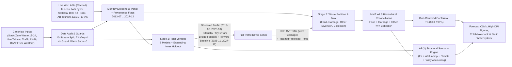

# Methodology — Town of Banff Coherent Monthly Forecasting & Scenario Pipeline

**Version:** `0.1.0`  
**Scope:** Monthly series (`2013-07` through `2027-12`) across 5 hierarchical Town of Banff municipal series: `Total Vehicles`, `Total Food Waste`, `Total Garbage`, `Other Diversion`, and `Total Collection` (`Food + Garbage + Other === Total Collection`).

---

## 1. Executive Architecture

This pipeline implements a **strictly leakage-free, two-stage forecasting, MinT hierarchical reconciliation, and structural econometric scenario system**. Every series is modeled on its native physical scale, linked causally from external macro/climate/tourism drivers through Town visitation into waste generation, and reconciled across all three mutually exclusive 13-stream components:

1. **Stage 1 — Visitor Traffic (`Total Vehicles`):**  
   - Observed Town two-way traffic counters (`2013-07` to `2026-10`, `n = 160` complete months across `4,882` complete daily rows), refreshed automatically from Town of Banff Tableau Public (`BanffTrafficData-GS.twb`) via `pantab`.
   - **`TrafficNowcaster`** remains calibrated (`n = 64` post-COVID months, `hwy_adj_r2 = 0.9874`, trailing 12-mo OOS bridge `MAPE = 2.59%`) and serves **strictly as an automatic standby fallback** with 80%/95% bridge intervals whenever Town Tableau counters lag behind **Highway 1 Banff Park Gates** (`is_realized_hwy1`) or **Banff National Park Attendance** (`is_realized_tourism`).
   - Forecasted forward (`2026-11..2027-12`) using climate, macro, lagged realized FX, calendar harmonics, and secular trend via a dynamically weighted `Ensemble_Top3`.
2. **Stage 2 — Municipal Waste Hierarchy (`Food Waste`, `Garbage`, `Other Diversion`, `Total Collection`):**  
   - Uniformly aggregated from `zero_waste_dashboard_data.csv` across `2018-01..2024-12` (`n = 84` months) over `CORE_13_MATERIALS`. Because the upstream Town of Banff Zero Waste Dashboard portal is offline, `zero_waste_dashboard_data.csv` serves as the canonical static waste archive.
   - Each series is conditioned strictly on Stage-1 traffic (`Total Vehicles`), weather anomalies/moisture, Alberta real hospitality receipts (`AB_FoodSvc_Real`), Alberta unemployment, calendar features, and bounded post-2021 Zero-Waste diversion saturation (`diversion_ramp`).
3. **Closed-Form MinT Hierarchical Reconciliation (`reconcile_waste_mint`):**  
   - Reconciles independent direct forecasts of `(Total Food Waste, Total Garbage, Other Diversion)` with direct `Total Collection` using out-of-fold CV inverse-variance (`RMSE²`) weights so `Food + Garbage + Other === Total Collection` holds to machine precision (`atol = 1e-9`) at every historical, CV, baseline, and scenario month.
4. **Bias-Centered Log-Normal Conformal Uncertainty:**  
   - Calibrated from empirical expanding-window OOF log-residuals, explicitly centering bounded median bias before applying square-root horizon scaling (`80%` and `95%` prediction intervals).
5. **Structural AR(1) Scenario Engine:**  
   - Stage 1 estimates `log_fx_ma3_lag3` (`+1.079, p = 2.0e-06`) and `ab_unemp_rate` (`-0.0196/pp, p = 0.0048`) over the full realized Bank of Canada FX window (`2013-12..2026-10`, `n = 155`, combining `FXUSDCAD` with BoC legacy noon `IEXE0101`, `DW = 1.977`). Stage 2 propagates endogenous traffic, climate, hospitality, and mass-conserving Zero-Waste policy levers (`2026-11..2027-12`) across all three waste streams.

---

## 2. Target Definitions & 3-Way Accounting Partition

Waste targets are aggregated uniformly from `src/banff_forecast/data_loader.py` (`load_waste_targets`), converting `Tonnes` (stored in **kilograms** inside `zero_waste_dashboard_data.csv`) by dividing by `1000.0`:

| Target Series | Exact Definition | Historical Window | CY 2024 Actual | CY 2027 Baseline (MinT) |
| :--- | :--- | :--- | ---: | ---: |
| `Total Vehicles` | Two-way monthly vehicle count (`Combined_TW` across West, East, Mountain Ave) | `2013-07..2026-10` (`n=160`) | 6,688,761 veh | 7,010,407 veh |
| `Total Food Waste` | `Commercial Food Waste + Residential Food Waste` | `2018-01..2024-12` (`n=84`) | 1,973.3 t | 2,382.2 t |
| `Total Garbage` | `Commercial Garbage + Residential Garbage + Town Run` | `2018-01..2024-12` (`n=84`) | 3,612.9 t | 3,507.6 t |
| `Other Diversion` | Remaining 8 `CORE_13_MATERIALS` streams (cardboard, paper, recyclables, glass, sundry, yard) | `2018-01..2024-12` (`n=84`) | 1,695.6 t | 1,593.8 t |
| `Total Collection` | Sum of all 13 `CORE_13_MATERIALS` streams (`Food + Garbage + Other`) | `2018-01..2024-12` (`n=84`) | 7,281.9 t | 7,483.6 t |

> [!NOTE]
> The 13 core material streams exclude irregular/construction bulk materials (such as Concrete, Construction, Gravel, Dry Wall, Tires, Kiln Dried Wood, Ballasts, Batteries, etc.) present across all 33 dashboard columns, reproducing the canonical CY 2024 municipal collection dashboard figure of `7,281.867 t` to `0.0000 t` discrepancy with exact 3-way component conservation (`Food + Garbage + Other === Total Collection`). Because the Town's public Zero Waste Dashboard portal is permanently offline, no live waste scraper is attached and `zero_waste_dashboard_data.csv` remains static.

---

## 3. Data Integrity, Domain Provenance & Gap-Repair Protocol

1. **Live Tableau Extraction & Traffic Integrity Guards (`fetch_banff_traffic_tableau`, `load_traffic_targets`):**
   - `fetch_banff_traffic_tableau()` downloads Tableau Public `BanffTrafficData-GS.twb` (retrying `{429, 500, 502, 503, 504}` with `Retry-After` + exponential backoff while failing fast on permanent `4xx`), extracts `.hyper` tables via `pantab`, deduplicates `(Counter, TimeStamp)`, aggregates explicitly via `groupby(["Counter", "Date"])` without `.iloc[0]` or silent `.fillna(0)` on auxiliary Counter `3`, requires `>= 23` observed hours/day on primary counters `1` & `2`, writes atomically via a `.tmp` UTF-16 TSV file validated through `load_traffic_targets()` before `os.replace()`, and falls back to the existing CSV on transient failure.
   - `load_traffic_targets()` supports both UTF-16 TSV Tableau exports and UTF-8 CSVs, enforces the 4x Tableau crosstab sanity guard (`median(Total Vehicles / (West_Entrance + East_Entrance)) <= 1.5`), excludes anomalous partial latest snapshot days (`< 0.15` × 30-day rolling median, e.g., Oct 31 = `87` vehicles, while safely preserving legitimate COVID lockdown minimums around `~0.25`), and requires `completeness = observed_days / days_in_month >= 1.0`.
2. **Climate Repair & Summer Snow Fix (`fetch_weather_monthly`):**
   - Appends live ECCC OGC `climate-daily` observations for **BANFF CS** (`3050519`) after `2025-01-05`.
   - Fills isolated station gaps with **Open-Meteo ERA5** (`51.1934°N, -115.5522°E`, `r = 0.9935`) + recent NWP tail (`_fetch_openmeteo_forecast`), adjusted for empirical calendar-month station bias.
   - Fixes missing warm-month `SNOW_ON_GROUND` (`month in {5..9}` or `MEAN_TEMPERATURE > 2.5°C`) to `0.0 cm` and drops incomplete trailing months (`< 20` valid days).
3. **Domain Provenance Flags & Scale-Normalized Extrapolation (`build_exogenous_panel`):**
   - Reads raw domain DataFrames independently prior to outer alignment so BoC `FXUSDCAD` (`+ IEXE0101` legacy pre-2017 noon splice, `2013-01..2026-11`, `n = 167`) is never truncated by an earlier weather cutoff.
   - Normalizes macro/tourism series by their median scale prior to damped `ExponentialSmoothing` so large-magnitude series (`AB_Retail_Total_SA`) converge cleanly without optimizer warnings.
   - Emits 5 explicit realization flags (`is_realized_weather`, `is_realized_macro`, `is_realized_tourism`, `is_realized_fx`, `is_realized_hwy1`). Whenever a synthetic or un-spliced cache lacks pre-2017 FX history, flat backfilled rows are marked `is_realized_fx = False` and automatically excluded from Stage-1 predictive & econometric regressions.

---

## 4. Feature Engineering, Model Suite & MinT Reconciliation

### 4.1 Feature Design (`features.py`)
- **Seasonal & Calendar:** Harmonics (`sin12`, `cos12`, `sin6`, `cos6`), `days_in_month`, `weekend_days`, Alberta statutory `ab_holidays` (`holidays.CA(subdiv="AB")`).
- **Regime Indicators:** `is_covid_acute` (`2020-03..2020-06`), `is_covid_era` (`2020-03..2021-06`).
- **Bounded Organics Transition (Waste Only):**  
  $$\text{diversion\_ramp}_t = 1 - \exp\!\left(-\frac{\max(0, m_t)}{18}\right)$$
  where $m_t$ is months since `2021-07-31`. Captures organics uptake plateauing without unbounded linear drift.
- **Climate & Macro:** `temp_anom`, `log1p_precip`, `snow_depth_scaled`, `log_fx`, `log_fx_ma3_lag3` (3-month trailing MA shifted 3 months for trip-booking FX lead), `log_foodsvc_real`, `ab_unemp_rate`, and (`Stage 2` only) `log_vehicles`.

### 4.2 Candidate Models & Data-Driven `Ensemble_Top3` (`models.py`)
1. `SeasonalNaive` (`season_length=12`), `AutoTheta`, `LogAutoARIMA`, `LogAutoETS` (StatsForecast).
2. `SARIMAX_Exo`: $\ln y \sim \text{SARIMAX}(1,0,0)(1,0,0)_{12}$ with standardized causal exogenous regressors (`maxiter=500`, clean Ridge fallback).
3. `Ridge_Exo`: `StandardScaler` + `RidgeCV` ($\alpha \in [0.1, 316.2]$) on $\ln y$.
4. `Hybrid_Ridge_LGBM`: Fits `Ridge_Exo` first, then fits regularized `LGBMRegressor` (`n_estimators=45`, `max_depth=2`, `num_leaves=4`, `min_child_samples=3`, `reg_lambda=1.0`, `reg_alpha=0.2`) on in-sample log-residuals with clipped future corrections ($\in [-0.25, +0.25]$), avoiding tree-split collapse on `n=48..84` monthly series.
5. `Ensemble_Top3`: Dynamically evaluates `[SARIMAX_Exo, Ridge_Exo, Hybrid_Ridge_LGBM, LogAutoETS]` across internal expanding holdouts (`24` and `12` months when $n \ge 72$; `12` months when $n \ge 48$), selects the top 3 models by mean holdout RMSE, and combines them with inverse-RMSE weights $w_m \propto \text{RMSE}_m^{-1}$.

### 4.3 Closed-Form MinT WLS Reconciliation (`reconcile_waste_mint`)
Let bottom component forecasts $\mathbf{b} = (\hat{F}, \hat{G}, \hat{O})^\top$ have out-of-sample error variances $(v_F, v_G, v_O) = (\text{RMSE}_F^2, \text{RMSE}_G^2, \text{RMSE}_O^2)$ and direct total forecast $\hat{C}$ have variance $v_C = \text{RMSE}_C^2$, with accounting discrepancy $\delta = \hat{C} - (\hat{F} + \hat{G} + \hat{O})$. Under diagonal MinT (WLS), minimum-trace coherent revisions satisfy:

$$w_{\text{bu}} = \frac{v_C}{v_C + v_F + v_G + v_O}, \qquad \tilde{C} = w_{\text{bu}}(\hat{F}+\hat{G}+\hat{O}) + (1 - w_{\text{bu}})\hat{C}$$
$$\tilde{b}_i = \hat{b}_i + \frac{v_i}{v_C + v_F + v_G + v_O}\,\delta \quad \text{for } i \in \{F, G, O\}, \qquad \tilde{F} + \tilde{G} + \tilde{O} \equiv \tilde{C}$$

On the full baseline (`2025-01..2027-12`), calibrated CV RMSEs assign $w_{\text{bu}} = 0.5847$ and $w_{\text{top}} = 0.4153$ (discrepancy shares: Food `9.36%`, Garbage `19.99%`, Other Diversion `12.18%`).

---

## 5. Leakage-Free Expanding CV & Benchmark Results

Cross-validation runs across three causal annual folds (`2022`, `2023`, `2024` = 36 common OOS months) over all 5 target series plus unseen extra traffic verification folds (`Fold_2025` across `12` months and adaptive `Fold_2026_YTD` across `10` months of `2026-01..2026-10`, held strictly non-common to keep the 2022–2024 benchmark & MinT weights apples-to-apples). In Stage-2 Waste folds, `log_vehicles` uses **only Stage-1 `Ensemble_Top3` out-of-fold predictions** for test periods. `MinT_Coherent` weights in each CV test fold are computed strictly leave-one-fold-out from the remaining folds.

| Target Series | Winning Model / MinT | 3-Yr OOS MAPE | 3-Yr OOS RMSE | OOS MASE | vs. `SeasonalNaive` RMSE |
| :--- | :--- | :---: | :---: | :---: | :---: |
| `Total Vehicles` | `Ensemble_Top3` *(`Fold_2025`: `5.10%` / `Hybrid 4.40%`; `Fold_2026_YTD`: `3.68%`)* | **5.67%** | **31,870 veh** | **0.44** | -38.2% (`51,546`) |
| `Total Food Waste` | **`MinT_Coherent`** *(Direct `Hybrid_Ridge_LGBM`: `10.57%` / `18.09 t`)* | **10.17%** | **17.80 t** | **0.45** | -55.5% (`40.01`) |
| `Total Garbage` | **`MinT_Coherent`** *(Direct `SeasonalNaive`: `7.28%` / `26.44 t`)* | **6.69%** | **24.10 t** | **0.36** | -8.8% (`26.44`) |
| `Other Diversion` | **`MinT_Coherent`** *(Direct `LogAutoETS`: `11.08%` / `20.63 t`)* | **10.99%** | **19.90 t** | **0.58** | -21.0% (`25.19`) |
| `Total Collection` | `SARIMAX_Exo` / **`MinT_Coherent`** | **6.23%** / **6.38%** | **45.21 t** / **45.92 t** | **0.38** / **0.39** | -37.6% / -36.7% (`72.50`) |

---

## 6. Traffic Nowcast Fallback & Bias-Centered Conformal Uncertainty

### 6.1 Standby `TrafficNowcaster` (Fallback When Tableau Lags Alberta Tourism)
Fitting post-COVID OLS log-models (`n = 64` aligned months from `2021-07`) achieves `Adj R² = 0.9874` on **Highway 1 Banff Park Gates** and `Adj R² = 0.9804` on **Banff National Park Attendance**. Prior to final fit, holding out the trailing 12 observed months measures empirical OOS bridge accuracy (`MAPE = 2.59%`, `bridge_hwy_log_sd = 0.0317`, `bridge_blend_log_sd = 0.0277`). Because live Tableau Public currently leads through `2026-10` ahead of Alberta Tourism (`2026-09`) and Hwy 1 (`2026-08`), `TrafficNowcaster` bridges `0` months today and activates automatically with 80% / 95% intervals only when future scheduled refreshes encounter Tableau lag.

### 6.2 Bias-Centered Conformal Prediction Intervals
For each target/model pair, expanding OOF log-errors $e_i = \ln(y_i) - \ln(\hat{y}_i)$ yield clamped median bias $\tilde{\mu} = \text{clip}(\text{median}(e_i), \pm 0.45 z_{0.90}\hat{\sigma}_c)$ and centered RMS dispersion $\hat{\sigma}_c = \max(0.03, \sqrt{\text{mean}(e_i - \tilde{\mu})^2})$:

$$m_h = \sqrt{\frac{1 + 0.03 (h - 1)}{1 + 0.03 \times 5.5}}, \qquad [\text{PI}_{1-\alpha}^{\text{low}}, \text{PI}_{1-\alpha}^{\text{high}}] = \hat{y}_{T+h} \cdot \exp\big(\tilde{\mu}\min(1, m_h) \mp z_{1-\alpha/2}\,\hat{\sigma}_c m_h\big)$$

---

## 7. Structural Econometric Scenario Engine (`AR(1)` + Coherent Policy Accounting)

Counterfactual what-if shocks (`2026-11..2027-12`) are estimated via two-stage `SARIMAX(1,0,0)` (`method="lbfgs", maxiter=800`) with 11 calendar-month fixed effects (`C(month)`) and mean-centered continuous regressors. Stage 1 fits across the genuinely realized BoC FX window (`IEXE0101` + `FXUSDCAD`, `2013-12..2026-10`, `n = 155` after 5-month lag burn-in):

| Target Series | $n$ | $\beta_{\text{log\_vehicles}}$ ($p$) | $\beta_{\text{temp\_anom}}$ ($p$) | $\beta_{\text{log1p\_precip}}$ | $\beta_{\text{macro/FX}}$ ($p$) | $\beta_{\text{AB\_Unemp}}$ ($p$) | AR(1) $\phi$ | Log $R^2$ | DW | LB $p(12)$ |
| :--- | :---: | :---: | :---: | :---: | :---: | :---: | :---: | :---: | :---: | :---: |
| `Total Vehicles` | 155 | — | **+0.0077** (`0.023`) | -0.0071 | **+1.079** (`2.0e-06`) | **-0.0196** (`0.0048`) | +0.190 | 0.953 | **1.977** | 0.304 |
| `Total Food Waste` | 84 | **+0.510** (`0.047`) | -0.0031 (`0.720`) | +0.0203 | **+0.811** (`0.045`) | — | 0.426 | 0.942 | **1.921** | 0.136 |
| `Total Garbage` | 84 | **+0.430** (`0.054`) | +0.0005 (`0.856`) | -0.0078 | +0.164 (`0.383`) | — | 0.860 | 0.934 | **2.392** | 0.606 |
| `Other Diversion` | 84 | **+0.540** (`0.035`) | **-0.0121** (`0.031`) | +0.0213 | -0.098 (`0.768`) | — | 0.219 | 0.820 | **2.054** | 0.106 |
| `Total Collection` | 84 | **+0.421** (`0.0007`) | -0.0021 (`0.388`) | +0.0054 | +0.191 (`0.168`) | — | 0.769 | 0.945 | **2.431** | 0.417 |

### Mass-Conserving Policy Accounting
When `source_reduction_pct` ($r$) or `garbage_to_food_shift_pct` ($s \in [0\%, 80\%]$) are applied on active counterfactual months after environmental/traffic multipliers $(F_{\text{env}}, G_{\text{env}}, O_{\text{env}})$:
1. $F' = F_{\text{env}}(1 - r),\quad G' = G_{\text{env}}(1 - r),\quad O' = O_{\text{env}}(1 - r)$
2. $\Delta D = s \cdot G'$ tonnes are diverted from Garbage:
   - $G_{\text{final}} = G' - \Delta D$
   - $F_{\text{final}} = F' + 0.75\,\Delta D$ (clean organics capture; 25% onsite moisture/compost reduction)
   - $O_{\text{final}} = O'$
   - $C_{\text{final}} = F_{\text{final}} + G_{\text{final}} + O_{\text{final}}$ (exact bottom-up conservation)

### Summary of CY 2027 Counterfactual Presets vs. Baseline (`7,010,407` veh, `2,382.2 t` Food, `3,507.6 t` Garb, `1,593.8 t` Other, `7,483.6 t` Coll)

| Scenario Preset | Total Vehicles | Total Food Waste | Total Garbage | Other Diversion | Total Collection |
| :--- | :---: | :---: | :---: | :---: | :---: |
| `High Tourism Boom (+12%)` | **+11.89%** | **+10.08%** | **+5.70%** | **+6.11%** | **+7.18%** |
| `Wildfire & Smoke Shock (-18% Summer)` | **-7.30%** | **-6.96%** | **-3.22%** | **-4.65%** | **-4.72%** |
| `Warm Climate Shift (+2.0 C)` | **+5.74%** | **+1.93%** | **+2.65%** | **+0.26%** | **+1.91%** |
| `Macro Slowdown & Strong CAD` *(endogenous)* | **-7.04%** | **-8.37%** | **-4.07%** | **-3.87%** | **-5.40%** |
| `Enhanced Zero-Waste Diversion (-15% Garbage)` | **0.00%** | **+13.07%** | **-17.55%** | **-3.00%** | **-4.70%** |
